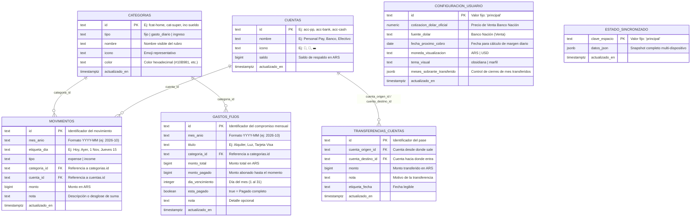

# 02. Base de Datos en Supabase (Esquema 100% en Español)

La aplicación **Realito** se sincroniza automáticamente en segundo plano con una base de datos PostgreSQL alojada en **Supabase**. Tanto los nombres de las tablas como todas sus columnas están definidos íntegramente en **español**.

- **Archivo SQL de migración:** [`supabase/migrations/0001_initial_schema.sql`](../supabase/migrations/0001_initial_schema.sql)
- **Script de verificación en vivo:** [`test/verify_supabase_live.js`](../test/verify_supabase_live.js)

---

## 1. Diagrama de las 7 Tablas en Español

---

## 2. Descripción Tabla por Tabla

| # | Nombre de la Tabla | Propósito en la App |
| :--- | :--- | :--- |
| **1** | `movimientos` | Registra todos los gastos diarios e ingresos cargados mes a mes, con su categoría (`categoria_id`), día (`etiqueta_dia`), monto y nota sanitizada. En el **Modelo B**, la carga se realiza en 2 segundos sin exigir al usuario seleccionar cuentas manualmente. |
| **2** | `gastos_fijos` | Checklist mensual de compromisos fijos por mes (`mes_anio`), con día de vencimiento (`1` al `31`), monto presupuestado, pagos parciales o totales y estado (`esta_pagado`). |
| **3** | `categorias` | Almacena los rubros clasificados en 3 familias mediante la columna `tipo`: **`fijo`** (Gastos Fijos), **`gasto_diario`** (Gastos Diarios) e **`ingreso`** (Ingresos). |
| **4** | `configuracion_usuario` | Preferencias del usuario: cotización vigente del Dólar Oficial (Venta — Banco Nación), fecha del próximo cobro de sueldo, moneda activa (`ARS`/`USD`), tema (`obsidiana`/`marfil`) y mapa de meses transferidos. |
| **5** | `estado_sincronizado` | Almacena una instantánea completa (`datos_json`) bajo la clave `'principal'` para hidratación ultra rápida en nuevos dispositivos o navegadores. |
| **6** | `cuentas` | Mantiene registradas las billeteras y cuentas de respaldo (`Personal Pay`, `Banco`, `Efectivo`), garantizando compatibilidad retroactiva total. |
| **7** | `transferencias_cuentas` | Registro histórico de movimientos de fondos entre billeteras. |

---

## 3. Arquitectura de Sincronización Automática

La persistencia funciona mediante una estrategia híbrida **Local-First + Sincronización en la Nube**:

1. **Escritura Inmediata en Memoria Local (`localStorage`):**
   - Cualquier acción (cargar un gasto, tildar un servicio, cambiar de mes o exportar un PDF) se aplica en **menos de 5 milisegundos**, garantizando respuesta instantánea sin bloqueos de red.
2. **Cola Outbox y Sincronización Asíncrona:**
   - La app despacha cambios hacia Supabase en segundo plano (`debounce` de 600 ms) mediante sentencias `UPSERT` (`Prefer: resolution=merge-duplicates`).
   - Si el teléfono pierde conexión, las operaciones se acumulan en la cola (`outboxQueue`) con estado `PENDING` y se sincronizan automáticamente en cuanto se restablece el acceso a internet (`isOnline = true`).
