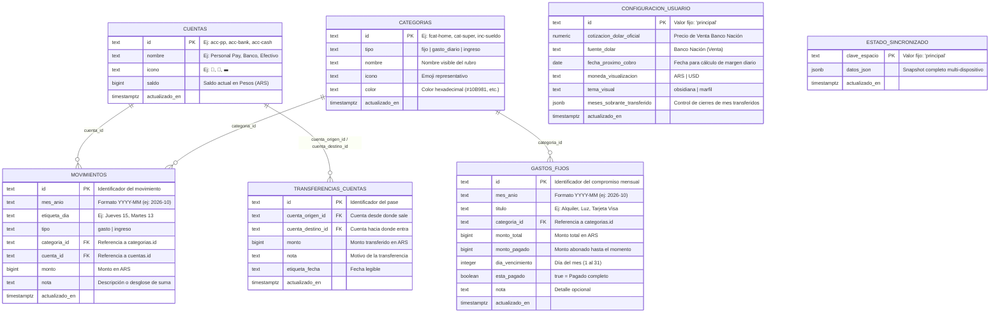

# 02. Base de Datos en Supabase (Esquema 100% en Español)

La aplicación **Realito** se sincroniza automáticamente en segundo plano con una base de datos PostgreSQL alojada en **Supabase**. Tanto los nombres de las tablas como todas sus columnas están definidos íntegramente en **español**.

- **Archivo SQL de migración:** [`supabase/migrations/0001_initial_schema.sql`](../supabase/migrations/0001_initial_schema.sql)
- **Script de verificación en vivo:** [`test/verify_supabase_live.js`](../test/verify_supabase_live.js)

---

## 1. Diagrama de las 7 Tablas en Español

---

## 2. Descripción Tabla por Tabla

| # | Nombre de la Tabla | Propósito en la App |
| :--- | :--- | :--- |
| **1** | `cuentas` | Guarda tus billeteras y cuentas activas (`Personal Pay`, `Banco`, `Efectivo` y cualquier otra que agregues), su ícono y su saldo actual en Pesos (`ARS`). |
| **2** | `categorias` | Almacena las 3 familias de rubros separadas por la columna `tipo`: **`fijo`** (Gastos Fijos), **`gasto_diario`** (Gastos Diarios) e **`ingreso`** (Ingresos). |
| **3** | `gastos_fijos` | Checklist mensual de pagos fijos por cada mes (`mes_anio`), con su día de vencimiento (`1` al `31`), monto total, monto pagado parcial o total y estado (`esta_pagado`). |
| **4** | `movimientos` | Todos los gastos diarios e ingresos cargados mes a mes, vinculados a la cuenta utilizada (`cuenta_id`), su categoría (`categoria_id`) y su día (`etiqueta_dia`). |
| **5** | `transferencias_cuentas` | Historial de pases de dinero entre tus propias cuentas (ej. de `Banco` a `Personal Pay`). Ajusta los saldos de ambas cuentas sin distorsionar los gastos ni ingresos del mes. |
| **6** | `configuracion_usuario` | Guarda tus preferencias globales: cotización vigente del Dólar Oficial (Venta — Banco Nación), fecha de tu próximo cobro, moneda activa (`ARS`/`USD`) y tema visual (`obsidiana`/`marfil`). |
| **7** | `estado_sincronizado` | Guarda una fotografía instantánea (`datos_json`) de todo el estado de la app bajo la clave `'principal'` para que al abrir la app en otro teléfono se hidrate toda la información en una sola lectura rápida. |

---

## 3. Cómo Funciona la Sincronización Automática (Sin Configuración Manual)

La conexión a la base de datos trabaja **100% por detrás de forma transparente**, sin mostrar paneles técnicos en la pantalla de Ajustes:

1. **Al abrir la aplicación (`pullFromSupabaseCloud`):**
   - La app consulta automáticamente Supabase en segundo plano y descarga la última versión sincronizada para que cualquier teléfono o computadora muestre exactamente los mismos saldos y movimientos.
2. **Al realizar cualquier cambio (`scheduleSupabaseCloudSync` → `pushAllToSupabaseCloud`):**
   - Cada vez que cargás un gasto/ingreso, editás un movimiento, marcás un gasto fijo como pagado, transferís entre cuentas o cambiás el tema visual, la app guarda primero en memoria local (`localStorage` en `< 5 ms`) y a los `600 ms` sincroniza automáticamente las **7 tablas en español** mediante `UPSERT` (`Prefer: resolution=merge-duplicates`).

